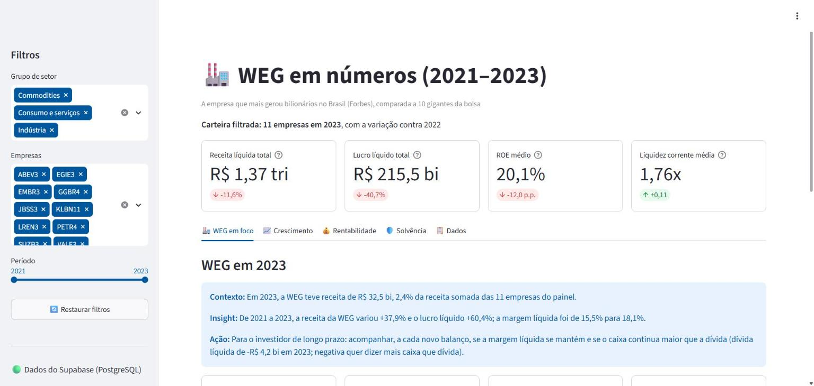
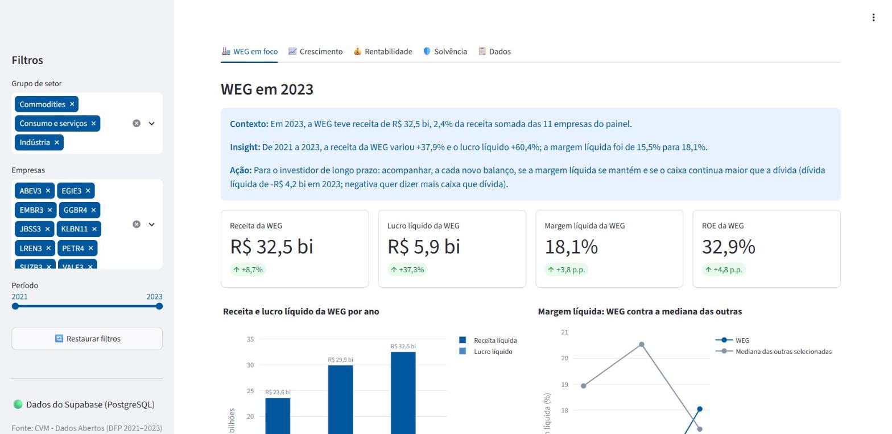
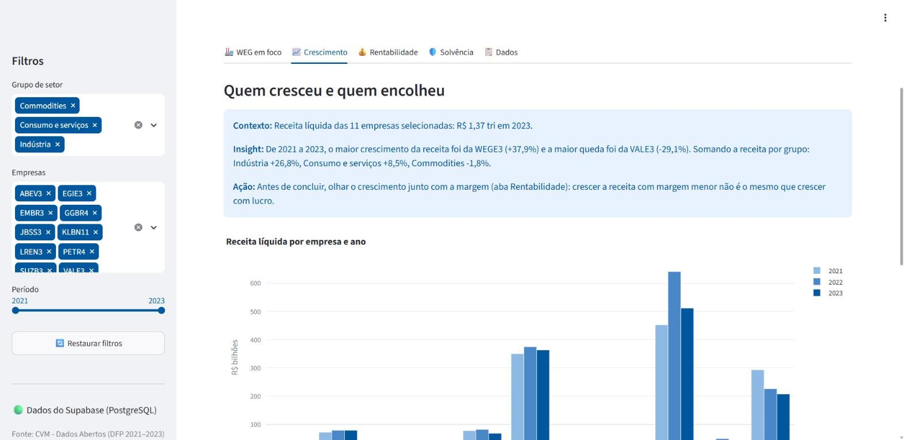
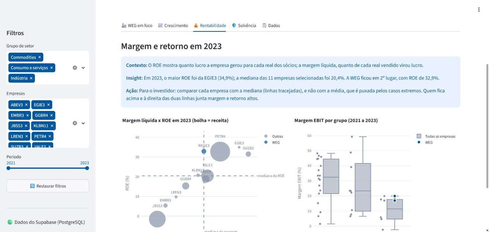
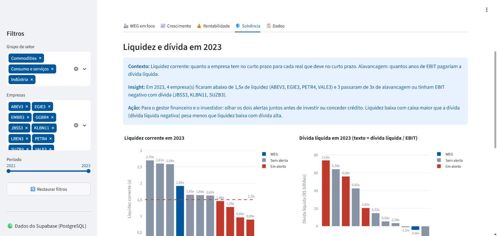
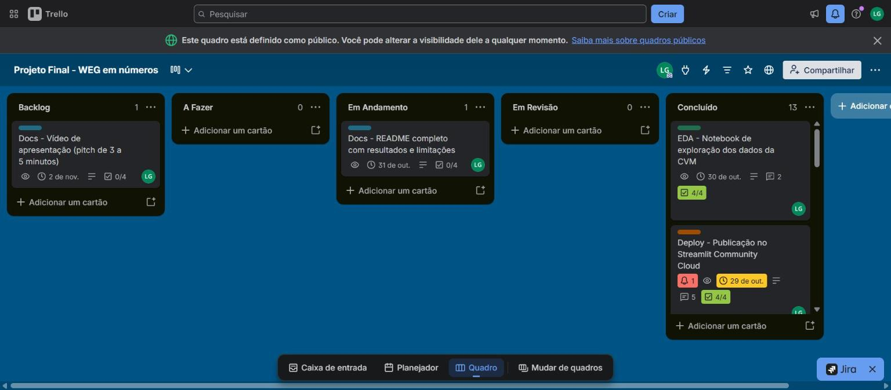

# WEG em números: análise fundamentalista 2021–2023

Projeto Avaliativo Final do Módulo 2 do curso Visualização de Dados e Business Intelligence (SCTEC), Linha 1: análise fundamentalista com os dados da CVM.

App publicado: **https://weg-em-numeros.streamlit.app** · Quadro no Trello: https://trello.com/b/sjInwKTN



## Resumo

Painel em Streamlit que compara a WEG com outras 10 grandes empresas da bolsa nos exercícios de 2021, 2022 e 2023, a partir das demonstrações financeiras (DFP) que as empresas entregam à CVM. Os dados passam por um pipeline em camadas (Bronze, Silver e Gold), ficam num banco PostgreSQL no Supabase e aparecem no app em 4 KPIs, 5 abas e 9 gráficos interativos.

Entre as 11 empresas, a WEG teve o maior crescimento de receita de 2021 a 2023 (+37,9%, de R$ 23,6 bi para R$ 32,5 bi), o segundo maior ROE de 2023 (32,9%, atrás da Engie) e mais caixa do que dívida nos três anos. Em 2023, 7 das 11 empresas aparecem em pelo menos um alerta: liquidez corrente abaixo de 1,5x ou dívida alta.

## Contexto e pergunta orientadora

Moro em Joinville, cidade vizinha de Jaraguá do Sul, onde a WEG nasceu em 1961. A WEG é conhecida como a empresa que mais gerou bilionários no Brasil: na lista da Forbes Brasil de 2023 ela aparece em primeiro lugar, com 29 bilionários das famílias fundadoras ([Forbes Brasil, 06/09/2023](https://forbes.com.br/forbes-money/2023/09/lista-da-forbes-2023-as-empresas-que-mais-geraram-bilionarios-no-brasil/)). A ideia do projeto é ver se a própria empresa sustenta essa fama nos números, comparada a outras gigantes da bolsa. O projeto não tenta explicar a riqueza das famílias: só olha o desempenho da empresa.

Pergunta orientadora:

> Como a WEG se saiu de 2021 a 2023, comparada a outras gigantes da bolsa, em crescimento, lucro, rentabilidade, liquidez e endividamento?

Para quem é o painel: o leitor principal é o investidor pessoa física de longo prazo, que quer saber se a WEG se sustenta nos números. O leitor secundário é o gestor financeiro de uma indústria da região, que usa a WEG como referência de desempenho. O painel mostra o que acompanhar e que alertas olhar; ele não recomenda comprar nem vender ações.

O app também responde às 5 perguntas oficiais da Linha 1:

| Pergunta | Onde está no app |
|---|---|
| 1. Quais empresas e setores mais cresceram em receita líquida entre 2021 e 2023, e quem encolheu? | aba Crescimento (barras por ano e ranking do crescimento) |
| 2. Qual empresa entregou o maior ROE e como a margem líquida se comportou nos três anos? | aba Rentabilidade (margem líquida x ROE) e aba WEG em foco (margem da WEG contra as outras) |
| 3. Como a margem EBIT das industriais se compara com a de commodities e de serviços? | aba Rentabilidade (boxplot da margem EBIT por grupo) |
| 4. Quais empresas estão vulneráveis em liquidez corrente (abaixo de 1,5x) e dívida líquida? | aba Solvência (barras de liquidez e de dívida, tabela de alertas) |
| 5. Como a receita do último ano se divide entre os setores? | aba Crescimento (mapa de árvore por grupo, setor e empresa) |

## Fonte dos dados e licença

- **Origem:** Portal de Dados Abertos da CVM, conjunto "Cias Abertas: Documentos: Formulário de Demonstrações Financeiras Padronizadas (DFP)" (https://dados.cvm.gov.br/dataset/cia_aberta-doc-dfp). Arquivos `dfp_cia_aberta_2021.zip`, `dfp_cia_aberta_2022.zip` e `dfp_cia_aberta_2023.zip`, em https://dados.cvm.gov.br/dados/CIA_ABERTA/DOC/DFP/DADOS/.
- **Período:** exercícios fiscais de 2021, 2022 e 2023 (balanços de 31 de dezembro).
- **Arquivos usados de cada zip:** DRE consolidada (`DRE_con`), balanço patrimonial ativo (`BPA_con`) e passivo (`BPP_con`).
- **Método de extração:** o `src/etl.py` baixa os zips com `requests` e lê os CSVs direto de dentro do zip, sem passo manual. Os arquivos usados foram baixados em 23/10/2026 (registro em `data/bronze/data_download.txt`). A CVM atualiza o conjunto toda semana para incluir os reenvios das empresas, por isso a data fica guardada.
- **Licença:** Licença Aberta para Bases de Dados (ODbL) do Open Data Commons, conforme a página do conjunto na CVM. São dados públicos de empresas, sem nenhum dado pessoal.

As empresas são as 12 sugeridas no enunciado menos o Itaú (ITUB4). Banco usa outro plano de contas: a conta 3.01 é receita de intermediação financeira, não existe ativo circulante e o patrimônio líquido fica na conta 2.08, então margens e liquidez do Itaú não se comparam com as das outras. O Itaú fica na camada Bronze e sai na Silver.

| Ticker | Empresa | Setor (cadastro da CVM, simplificado) | Grupo |
|---|---|---|---|
| WEGE3 | WEG S.A. | Máquinas e Equipamentos | Indústria |
| EMBR3 | Embraer S.A. | Máquinas e Equipamentos | Indústria |
| VALE3 | Vale S.A. | Extração Mineral | Commodities |
| GGBR4 | Gerdau S.A. | Metalurgia e Siderurgia | Commodities |
| KLBN11 | Klabin S.A. | Papel e Celulose | Commodities |
| SUZB3 | Suzano S.A. | Papel e Celulose | Commodities |
| PETR4 | Petrobras | Petróleo e Gás | Commodities |
| JBSS3 | JBS S.A. | Alimentos | Commodities |
| ABEV3 | Ambev S.A. | Bebidas | Consumo e serviços |
| LREN3 | Lojas Renner S.A. | Comércio (varejo) | Consumo e serviços |
| EGIE3 | Engie Brasil Energia S.A. | Energia Elétrica | Consumo e serviços |

O grupo é uma classificação nossa, feita para a pergunta 3 (indústria x commodities x serviços).

## Pipeline de dados

Arquitetura em camadas (Bronze, Silver e Gold), feita em pandas no `src/etl.py`. O ETL roda com `python src/etl.py` e imprime a conferência de cada camada.

1. **Bronze:** baixa os três zips para `data/bronze/zips/` (fora do git, porque o ETL baixa de novo) e grava, sem mudar nada, as linhas das 12 empresas em `data/bronze/dfp_con_2021_2023.csv` (16.032 linhas), com uma coluna dizendo de qual arquivo veio cada linha.
2. **Silver:** limpeza, uma regra por passo, com a contagem de linhas impressa depois de cada um:
   - encoding: os CSVs da CVM estão em latin-1; lidos como UTF-8 dão `UnicodeDecodeError`;
   - exercício: cada arquivo traz o ano (`ÚLTIMO`) e o ano anterior (`PENÚLTIMO`); fica só o `ÚLTIMO`;
   - versões: quem corrigiu o DFP reenviou com `VERSAO` maior (Klabin 2021, Engie 2022, Vale 2022 e Petrobras 2023); fica a maior, convertida para número antes de comparar (como texto, "10" vem antes de "9");
   - empresas: sai o Itaú;
   - contas: ficam só as 13 contas usadas nos indicadores;
   - valores: `VL_CONTA` vira número e é multiplicado por 1000 (escala `MIL`), ficando em reais;
   - datas: `DT_REFER`, `DT_INI_EXERC` e `DT_FIM_EXERC` viram data, e o ano sai do fim do exercício;
   - nulos e duplicados: conferidos e impressos (0 nulos e 0 duplicados).

   Resultado: `data/silver/contas_2021_2023.csv`, com 429 linhas (11 empresas x 3 anos x 13 contas) no formato longo.
3. **Gold:** o `src/indicadores.py` calcula margens, ROE, liquidez corrente, dívida líquida, alavancagem e os alertas, e o ETL monta o esquema estrela em `data/gold/`: `dim_empresa` (11 linhas), `dim_tempo` (3) e `fato_indicadores` (33). O grão da fato é uma linha por empresa por exercício.
4. **Banco:** o `src/carga_supabase.py` roda o `sql/criar_tabelas.sql` (as três tabelas, com chave primária e chave estrangeira) no Supabase e carrega a Gold, primeiro as dimensões e depois a fato. O `sql/consultas.sql` tem as consultas das perguntas de negócio (ranking do ROE, crescimento da receita, empresas em alerta), sempre a partir da fato com JOIN nas dimensões.
5. **App:** lê o Supabase com `st.connection` e guarda o resultado em cache por 10 minutos. Se o banco não responder, usa os CSVs da Gold e avisa na barra lateral.

Arrendamentos: desde a norma IFRS 16, aluguéis longos contam como dívida. Petrobras e Vale lançam esse valor dentro dos empréstimos (contas 2.01.04.03 e 2.02.01.03); as outras 9 empresas deixam essas contas zeradas. Para comparar igual, a dívida líquida aqui tira os arrendamentos (Petrobras 2023: R$ 64,2 bi sem os arrendamentos contra R$ 227,8 bi com eles).

O notebook `notebooks/01_exploracao.ipynb` mostra a exploração que levou a essas regras (o erro de encoding, as versões, o caso do Itaú e os arrendamentos) e confere um número da Gold com a fonte oficial: a receita da WEG em 2023 (R$ 32.503.601 mil) é a mesma do release de resultados da empresa.

## Dicionário de dados

A camada Gold é um esquema estrela com duas dimensões e uma tabela fato, nos arquivos de `data/gold/`. O grão da fato é uma linha por empresa por exercício fiscal (11 empresas x 3 anos = 33 linhas). Os valores estão em reais (R$), já multiplicados pela escala da CVM. Margens e ROE estão em fração (0,329 = 32,9%); liquidez e alavancagem estão em vezes (1,92 = 1,92x).

### dim_empresa (11 linhas)

| Coluna | Tipo | Significado | Regra |
|---|---|---|---|
| `empresa_sk` | inteiro | chave da empresa (PK) | chave substituta, de 1 a 11 em ordem alfabética de ticker (WEGE3 = 11) |
| `ticker` | texto | código da ação na B3 | ex.: WEGE3 |
| `cd_cvm` | texto | código da empresa na CVM | como vem no DFP, com 6 dígitos |
| `cnpj` | texto | CNPJ da companhia | cadastro da CVM |
| `nome` | texto | nome da empresa | cadastro da CVM |
| `setor` | texto | setor de atuação | cadastro da CVM, simplificado |
| `grupo` | texto | grupo usado para comparar setores (pergunta 3) | Indústria, Commodities ou Consumo e serviços (classificação nossa) |

### dim_tempo (3 linhas)

| Coluna | Tipo | Significado | Regra |
|---|---|---|---|
| `tempo_sk` | inteiro | chave do ano (PK) | chave substituta, de 1 a 3 |
| `ano` | inteiro | exercício fiscal | 2021, 2022 e 2023 |
| `data_inicio` | data | início do exercício | 1º de janeiro |
| `data_fim` | data | fim do exercício (data do balanço) | 31 de dezembro |

### fato_indicadores (33 linhas)

| Coluna | Tipo | Significado | Regra |
|---|---|---|---|
| `indicador_sk` | inteiro | chave da linha (PK) | chave substituta, de 1 a 33 |
| `empresa_sk` | inteiro | empresa (FK) | liga com a `dim_empresa` |
| `tempo_sk` | inteiro | ano (FK) | liga com a `dim_tempo` |
| `receita` | decimal | receita líquida de vendas e serviços | conta 3.01 da DRE |
| `lucro_bruto` | decimal | receita menos o custo do que foi vendido | conta 3.03 |
| `ebit` | decimal | resultado operacional, antes do resultado financeiro e dos impostos | conta 3.05 |
| `lucro_liquido` | decimal | lucro líquido consolidado (inclui a parte dos acionistas minoritários) | conta 3.11 |
| `ativo_circulante` | decimal | dinheiro e direitos que viram dinheiro em até 12 meses | conta 1.01 do balanço |
| `passivo_circulante` | decimal | dívidas e contas que vencem em até 12 meses | conta 2.01 |
| `patrimonio_liquido` | decimal | patrimônio líquido consolidado no fim do ano | conta 2.03 |
| `caixa` | decimal | caixa e equivalentes de caixa | conta 1.01.01 |
| `aplicacoes` | decimal | aplicações financeiras | conta 1.01.02 |
| `emprestimos` | decimal | empréstimos e financiamentos de curto e longo prazo | 2.01.04 + 2.02.01 |
| `arrendamentos` | decimal | aluguéis contados como dívida (IFRS 16) que algumas empresas lançam dentro dos empréstimos | 2.01.04.03 + 2.02.01.03 (0 quando a conta não existe) |
| `divida_liquida` | decimal | dívida menos o dinheiro em caixa; negativa quando a empresa tem mais caixa que dívida | emprestimos - arrendamentos - caixa - aplicacoes |
| `margem_bruta` | decimal | parte da receita que sobra depois do custo | lucro_bruto / receita |
| `margem_ebit` | decimal | margem operacional | ebit / receita |
| `margem_liquida` | decimal | parte da receita que vira lucro | lucro_liquido / receita |
| `roe` | decimal | retorno sobre o patrimônio dos sócios | lucro_liquido / patrimonio_liquido |
| `liquidez_corrente` | decimal | quanto a empresa tem no curto prazo para cada real que deve no curto prazo | ativo_circulante / passivo_circulante |
| `alavancagem` | decimal | quantos anos de EBIT pagariam a dívida líquida | divida_liquida / ebit; vazio quando o EBIT é zero ou negativo |
| `alerta_liquidez` | booleano | alerta de liquidez (pergunta 4) | liquidez_corrente abaixo de 1,5 |
| `alerta_divida` | booleano | alerta de dívida (pergunta 4) | alavancagem acima de 3, ou EBIT zero ou negativo com dívida líquida positiva |

O enunciado cita Dívida Líquida / EBITDA. Aqui a alavancagem usa o EBIT, porque a depreciação não vem nos três arquivos usados (DRE, BPA e BPP); com o EBIT o número fica um pouco maior, ou seja, mais conservador.

O crescimento da receita não fica na fato, porque depende do período escolhido no filtro: o app calcula receita do último ano / receita do primeiro ano - 1.

A camada Silver (`data/silver/contas_2021_2023.csv`) fica no formato longo, com uma linha por empresa, ano e conta, e as colunas `cd_cvm`, `ticker`, `ano`, `demonstrativo` (DRE, BPA ou BPP), `cd_conta`, `ds_conta`, `valor` (em R$), `versao` (versão do DFP usada) e `dt_refer` (data de referência do documento).

## Tecnologias

| Ferramenta | Para quê | Por quê |
|---|---|---|
| Python 3.12 | todo o projeto | as versões das bibliotecas da aula instalam juntas nele, e é a mesma versão usada no Streamlit Cloud |
| pandas 3.0.6 | ETL e cálculo dos indicadores | leitura dos CSVs da CVM, filtros, pivot e merge, como nas aulas |
| requests 2.34.2 | download dos zips da CVM | baixa os arquivos direto do portal, sem passo manual, e o ETL pode ser refeito do zero |
| Supabase (PostgreSQL) | banco de dados na nuvem | plano gratuito com Postgres de verdade, o mesmo usado nas aulas |
| SQLAlchemy 2.1.4 e psycopg 3.3.6 | conexão com o PostgreSQL | o `st.connection` usa o SQLAlchemy; o psycopg 3.3.6 tem pacote pronto para o Python 3.12 e versões mais novas (a 3.1.18 da aula não tem para o 3.13 em diante) |
| toml 0.10.2 | ler o `secrets.toml` na carga do banco | mesmo padrão do script de carga da aula |
| Streamlit 1.65.0 | o app | filtros na barra lateral, abas, `st.metric`, cache e `session_state`, com deploy gratuito no Streamlit Community Cloud |
| Plotly Express (plotly 7.1.0) | os 9 gráficos do app | gráficos interativos: valores ao passar o mouse, zoom e legenda clicável |
| Jupyter e matplotlib | notebook de exploração | os gráficos do notebook ficam salvos como imagem e aparecem no GitHub sem rodar nada |
| Git, GitHub e Trello | versionamento e gestão | GitFlow com uma branch por card do Kanban |

As versões das bibliotecas do app estão fixas no `requirements.txt`. O Jupyter e o matplotlib são só para o notebook (`pip install notebook matplotlib`).

## Principais resultados

Números do filtro padrão do app (11 empresas, 2021 a 2023), em reais, sem correção pela inflação. Os gráficos citados estão nos prints da seção [Demonstração do app](#demonstração-do-app).

**1. Crescimento da receita.** A WEG foi a empresa que mais cresceu: a receita passou de R$ 23,6 bi em 2021 para R$ 32,5 bi em 2023 (+37,9%), e o lucro líquido de R$ 3,66 bi para R$ 5,87 bi. Depois vêm a Renner (+29,1%) e a Embraer (+15,2%). Quatro empresas encolheram no período: Vale (-29,1%), Engie (-14,3%), Gerdau (-12,0%) e Suzano (-3,0%), três delas de commodities. Em 2023 a carteira toda encolheu contra 2022 (receita -11,6% e lucro -40,7%), enquanto a WEG cresceu 8,7% em receita e 37,3% em lucro.

| Empresa | Grupo | Receita 2021 | Receita 2023 | Crescimento |
|---|---|---|---|---|
| WEGE3 | Indústria | R$ 23,6 bi | R$ 32,5 bi | +37,9% |
| LREN3 | Consumo e serviços | R$ 10,6 bi | R$ 13,6 bi | +29,1% |
| EMBR3 | Indústria | R$ 22,7 bi | R$ 26,1 bi | +15,2% |
| PETR4 | Commodities | R$ 452,7 bi | R$ 512,0 bi | +13,1% |
| ABEV3 | Consumo e serviços | R$ 72,9 bi | R$ 79,7 bi | +9,4% |
| KLBN11 | Commodities | R$ 16,5 bi | R$ 18,0 bi | +9,4% |
| JBSS3 | Commodities | R$ 350,7 bi | R$ 363,8 bi | +3,7% |
| SUZB3 | Commodities | R$ 41,0 bi | R$ 39,8 bi | -3,0% |
| GGBR4 | Commodities | R$ 78,3 bi | R$ 68,9 bi | -12,0% |
| EGIE3 | Consumo e serviços | R$ 12,5 bi | R$ 10,7 bi | -14,3% |
| VALE3 | Commodities | R$ 293,5 bi | R$ 208,1 bi | -29,1% |

**2. Retorno e margem.** Em 2023 o maior ROE foi da Engie (34,9%), e a WEG ficou em segundo lugar (32,9%), bem acima da mediana das 11 empresas (20,4%). O ROE da WEG subiu nos três anos: 26,1%, 28,0% e 32,9%. Já a margem líquida da WEG caiu de 15,5% para 14,3% em 2022 e subiu para 18,1% em 2023. Em 2021 e 2022 ela ficou abaixo da mediana das 11, e em 2023 a WEG ficou exatamente no meio (6ª de 11). Ou seja, a WEG está entre os maiores retornos sobre o patrimônio com uma margem líquida na média do grupo. A JBS teve prejuízo em 2023 (ROE de -1,6%).

**3. Margem EBIT por grupo.** Juntando os três anos, a mediana da margem EBIT foi de 32,4% em commodities, 23,3% em consumo e serviços e 11,4% na indústria. O grupo indústria tem só duas empresas, então a mediana fica entre elas: a WEG teve margem EBIT de 16,9% a 19,9%, e a Embraer de -2,4% a 5,8%. As margens variam muito dentro de cada grupo; em commodities, por exemplo, vão de 1,5% (JBS em 2023) a 48,2% (Vale em 2021).

**4. Vulnerabilidade financeira.** Em 2023, 7 das 11 empresas tiveram pelo menos um alerta. Ambev (0,89x), Petrobras (0,96x), Vale (1,28x) e Engie (1,46x) ficaram com liquidez corrente abaixo de 1,5x. JBS (13,8x), Klabin (4,9x) e Suzano (4,6x) passaram de 3x de alavancagem (dívida líquida / EBIT). A Ambev tem a menor liquidez, mas tem mais caixa do que dívida (dívida líquida de -R$ 12,8 bi), então os dois alertas precisam ser lidos juntos. A WEG não teve alerta: liquidez de 1,9x e dívida líquida negativa nos três anos (-R$ 4,2 bi em 2023).

**5. Distribuição da receita.** Em 2023 as 11 empresas somaram R$ 1,37 tri de receita, e 88,1% veio de commodities (consumo e serviços 7,6%, indústria 4,3%). Só Petrobras (37,3%), JBS (26,5%) e Vale (15,2%) somam 79% do total. A WEG representa 2,4%: perto das gigantes de commodities ela é pequena em valor, e o destaque dela está no crescimento e no retorno, não no tamanho.

## Discussão e limitações

Os números mostram o que aconteceu com essas 11 empresas de 2021 a 2023, mas não explicam por que aconteceu. Não dá para dizer, por exemplo, que a margem ou o ROE da WEG explicam a fortuna das famílias fundadoras, nem que o crescimento vai se repetir nos próximos anos.

O que pesa na leitura dos resultados:

- são só 3 anos e 11 empresas, e o grupo indústria tem duas empresas, então a mediana dele depende muito da Embraer;
- os valores são nominais: o crescimento não desconta a inflação do período;
- o lucro usado é o consolidado (conta 3.11), que inclui a parte dos minoritários; as notícias usam o lucro dos controladores (WEG 2023: R$ 5,87 bi consolidado contra R$ 5,73 bi dos controladores);
- o EBIT da CVM (conta 3.05) inclui a equivalência patrimonial, o que pesa na Vale, na Petrobras e na Engie;
- a alavancagem usa o EBIT e não o EBITDA que o enunciado cita, porque a depreciação não vem nos três arquivos usados; com o EBIT o número fica um pouco maior, ou seja, mais conservador;
- a dívida líquida não conta arrendamentos nem derivativos, então pode ser diferente da que a empresa divulga no release;
- a receita da Renner inclui cerca de R$ 2,0 bi de serviços financeiros, e o lucro da Vale em 2021 e 2022 inclui operações descontinuadas;
- o corte de 1,5x de liquidez vem do enunciado e o de 3x de alavancagem é uma régua comum de mercado; com outros cortes, a lista de empresas em alerta muda;
- o Itaú ficou de fora, porque banco usa outro plano de contas.

Próximos passos: incluir 2024 e 2025 (o ETL só precisa de mais anos na lista `ANOS`), corrigir os valores pela inflação e comparar a WEG com mais empresas da indústria.

## Aplicação profissional

Para o investidor pessoa física de longo prazo, o painel serve como uma primeira triagem antes de ler os balanços: comparar a margem e o ROE de cada empresa com a mediana das outras, olhar os dois alertas juntos (liquidez e dívida) e, a cada novo balanço, conferir se a WEG mantém a margem e o caixa maior que a dívida. O painel não é recomendação de compra ou venda.

Para o gestor financeiro de uma indústria da região, a WEG serve de referência: dá para comparar a margem EBIT e a liquidez da própria empresa com as da WEG e com a mediana da indústria. A regra de alerta do painel (liquidez abaixo de 1,5x ou alavancagem acima de 3x) pode virar um checklist simples antes de dar crédito a um cliente ou de fechar contrato com um fornecedor grande.

Para um diretor financeiro, o pipeline mostra como montar esse acompanhamento com dados públicos e gratuitos da CVM, atualizado a cada novo DFP, sem digitar nenhum número à mão.

## Demonstração do app

App publicado no Streamlit Community Cloud: **https://weg-em-numeros.streamlit.app**

Guia de navegação:

1. **Barra lateral:** escolha os grupos de setor (Indústria, Commodities, Consumo e serviços). A lista de empresas muda junto com os grupos (filtro cruzado), e dá para tirar ou pôr empresas uma a uma. Escolha o período, de 2021 a 2023. O botão "Restaurar filtros" volta tudo ao padrão. Embaixo aparece de onde vieram os dados: 🟢 Supabase (PostgreSQL) ou 🟡 CSV local, quando o banco não responde.
2. **Topo:** 4 KPIs da carteira filtrada no último ano do período (receita líquida total, lucro líquido total, ROE médio e liquidez corrente média), com a variação contra o ano anterior.
3. **Abas:** cada uma abre com um texto curto em três partes (Contexto, Insight e Ação), com os números calculados a partir dos filtros.
   - **WEG em foco:** 4 indicadores da WEG, receita e lucro da WEG por ano e a margem líquida da WEG contra a média das outras empresas selecionadas.
   - **Crescimento:** receita por empresa e ano, ranking do crescimento da receita no período e mapa de árvore da receita do último ano por grupo, setor e empresa.
   - **Rentabilidade:** margem líquida x ROE em quadrantes (o tamanho da bolha é a receita, as linhas tracejadas são as medianas) e boxplot da margem EBIT por grupo.
   - **Solvência:** liquidez corrente com a linha de 1,5x, dívida líquida com a alavancagem escrita em cada barra e a tabela das empresas em alerta, com o motivo.
   - **Dados:** tabela filtrada, botão para baixar em CSV, dicionário de dados e limitações.
4. **Nos gráficos:** passe o mouse para ver os valores, arraste para dar zoom e clique na legenda para esconder ou mostrar um grupo. Nos gráficos que comparam empresas, a WEG aparece em azul e as outras em cinza; o vermelho marca queda ou alerta.

Os dados vêm do Supabase (PostgreSQL). Se o banco não responder, o app usa os CSVs da camada Gold e avisa na barra lateral.









## Como executar localmente

Precisa do Python 3.12 e do Git. No terminal (comandos do Windows):

```bash
git clone https://github.com/gobels2/Projeto-Avaliativo-Final-Modulo-2-SCTEC.git
cd Projeto-Avaliativo-Final-Modulo-2-SCTEC
py -3.12 -m venv .venv
.venv\Scripts\activate
pip install -r requirements.txt
```

Para ler os dados do Supabase, copie o `.streamlit/secrets.toml.example` para `.streamlit/secrets.toml` e preencha com os dados do seu projeto (botão Connect > Session pooler). Esse arquivo está no `.gitignore` e não vai para o GitHub. Sem ele o app funciona do mesmo jeito, lendo os CSVs da camada Gold (`data/gold/`), e avisa isso na barra lateral.

Para abrir o app:

```bash
streamlit run app.py
```

Para refazer os dados do zero (opcional):

```bash
# baixa os DFPs da CVM e gera as camadas Bronze, Silver e Gold
python src/etl.py
# cria as tabelas no Supabase e carrega a Gold (precisa do secrets.toml)
python src/carga_supabase.py
```

## Estrutura de pastas

```text
Projeto-Avaliativo-Final-Modulo-2-SCTEC/
├── app.py                     # app Streamlit (dashboard)
├── requirements.txt           # bibliotecas com versão fixa
├── .streamlit/
│   ├── config.toml            # tema do app (azul da WEG)
│   └── secrets.toml.example   # modelo da conexão com o Supabase
├── data/
│   ├── bronze/                # dados brutos da CVM (DRE, BPA e BPP 2021–2023) e registro do download
│   ├── silver/                # só as contas usadas, limpas, uma linha por empresa, ano e conta
│   └── gold/                  # esquema estrela: dim_empresa, dim_tempo e fato_indicadores
├── notebooks/                 # notebook de exploração dos dados
├── src/
│   ├── etl.py                 # extração e limpeza (Bronze, Silver e Gold)
│   ├── indicadores.py         # cálculo dos indicadores financeiros
│   └── carga_supabase.py      # carga da Gold no Supabase
├── sql/
│   ├── criar_tabelas.sql      # tabelas com chave primária e chave estrangeira
│   └── consultas.sql          # consultas das perguntas de negócio
└── docs/img/                  # prints usados no README
```

## Gestão ágil e links do projeto

- **Quadro Kanban no Trello (público):** https://trello.com/b/sjInwKTN
- **App no Streamlit Community Cloud:** https://weg-em-numeros.streamlit.app
- **Repositório:** https://github.com/gobels2/Projeto-Avaliativo-Final-Modulo-2-SCTEC

O quadro tem as colunas Backlog, A Fazer, Em Andamento, Em Revisão e Concluído. Cada card é uma etapa do projeto, com etiqueta (ETL, Banco, App, Deploy ou Docs), história de usuário, critérios de aceite e checklist de pronto. Só um card fica em Em Andamento por vez. Cada card tem a sua branch `feature/...`, criada a partir da `develop`. Quando o Pull Request é aberto, o card vai para Em Revisão; depois do merge na `develop`, vai para Concluído com o link do PR nos comentários. A `main` recebe a `develop` por Pull Request nas entregas.



## Autoria e referências

Projeto individual de **Leo Gobel** (GitHub: [gobels2](https://github.com/gobels2)) para o curso Visualização de Dados e Business Intelligence – T2 (SCTEC), professor Savio Ricardo Garcia.

Referências consultadas:

- CVM, Portal de Dados Abertos. Formulário de Demonstrações Financeiras Padronizadas (DFP). https://dados.cvm.gov.br/dataset/cia_aberta-doc-dfp
- Forbes Brasil. Lista Forbes 2023: as empresas que mais geraram bilionários no Brasil, 06/09/2023. https://forbes.com.br/forbes-money/2023/09/lista-da-forbes-2023-as-empresas-que-mais-geraram-bilionarios-no-brasil/
- WEG, Central de Resultados (release do 4º trimestre de 2023, usado para conferir a receita de 2023). https://ri.weg.net/informacoes-financeiras/central-de-resultados/
- Releases de resultados de 2021 a 2023 das empresas analisadas, nos sites de relações com investidores, usados para conferir receita, lucro e patrimônio extraídos da CVM.
- Aulas do Módulo 2 (pipeline Bronze, Silver e Gold; Streamlit; Supabase; Kanban) e do Módulo 1 (modelagem dimensional).
- Repositórios das aulas, base do padrão de conexão, cache e fallback em CSV do app: https://github.com/Visualizacao-Dados-BI-T2/M2_Semana_10 e https://github.com/Visualizacao-Dados-BI-T2/M2_Semana_11
- Documentação do Streamlit (`st.connection`, `st.cache_data`, `st.session_state`, `st.tabs`, `st.metric`): https://docs.streamlit.io
- Documentação do Plotly Express: https://plotly.com/python/plotly-express/
- Documentação do Supabase (conexão com o Postgres): https://supabase.com/docs/guides/database/connecting-to-postgres
- Documentação do pandas: https://pandas.pydata.org/docs/
